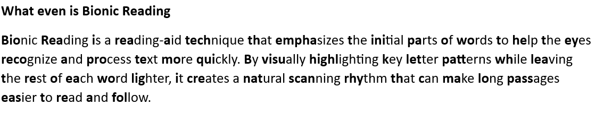

# Bionic Overlay

A read-only **Bionic Reading overlay for Windows**. It captures a screen region, OCRs the text, and draws a transparent click-through overlay that bolds the beginning of each word—without modifying the underlying application.

## Features

- Works with browsers, PDF viewers, remote desktops, and other Windows apps
- OCR-powered word detection
- Region, Window, and Screen modes
- Change detection and OCR caching for low CPU usage
- Adjustable font scale, offsets, spacing, and bold ratio
- Debug boxes for alignment troubleshooting
- Optional Tesseract/PaddleOCR engines
- Configurable global hotkeys
- Native bolding support for Microsoft Office

##  Installation

**Requirements:** Windows 10 (2004+) / Windows 11, Python 3.10+ 64-bit.

```powershell
git clone <repository-url>
cd bionic-overlay
python launcher.py
```

The launcher can install missing dependencies automatically.

Or
Download exe and run: 

## Usage

1. Launch the application.
2. Press `Ctrl+Alt+S` and select a region containing text.
3. Press `Ctrl+Alt+O` to toggle the overlay.
4. Use `Ctrl+Alt+R` to force a fresh OCR pass.
5. Press `Ctrl+Alt+D` to display debug boxes.

### Default Hotkeys

| Shortcut | Action |
|---|---|
| `Ctrl+Alt+O` | Toggle overlay |
| `Ctrl+Alt+R` | Re-OCR |
| `Ctrl+Alt+P` | Pause / resume |
| `Ctrl+Alt+S` | Select region |
| `Ctrl+Alt+W` | Window mode |
| `Ctrl+Alt+D` | Debug boxes |
| `Esc` | Disable overlay |

## Windows OCR is default, alternatives:

1. Tesseract: its boxes are often rougher than Windows OCR’s on screen text. It’s worth a try only if Windows OCR struggles with a language or script you need. It gives real confidence scores, so the low-confidence filter works properly. It needs the Tesseract program installed on your PC.

2. PaddleOCR: it can read stylised fonts, low-contrast text or photos of text better. It’s slow on a CPU and adds hundreds of MB. It returns whole-line boxes and code splits them into words by estimating, so alignment is likely to be worse than with Windows OCR. That estimation is also why the engine is marked experimental.
